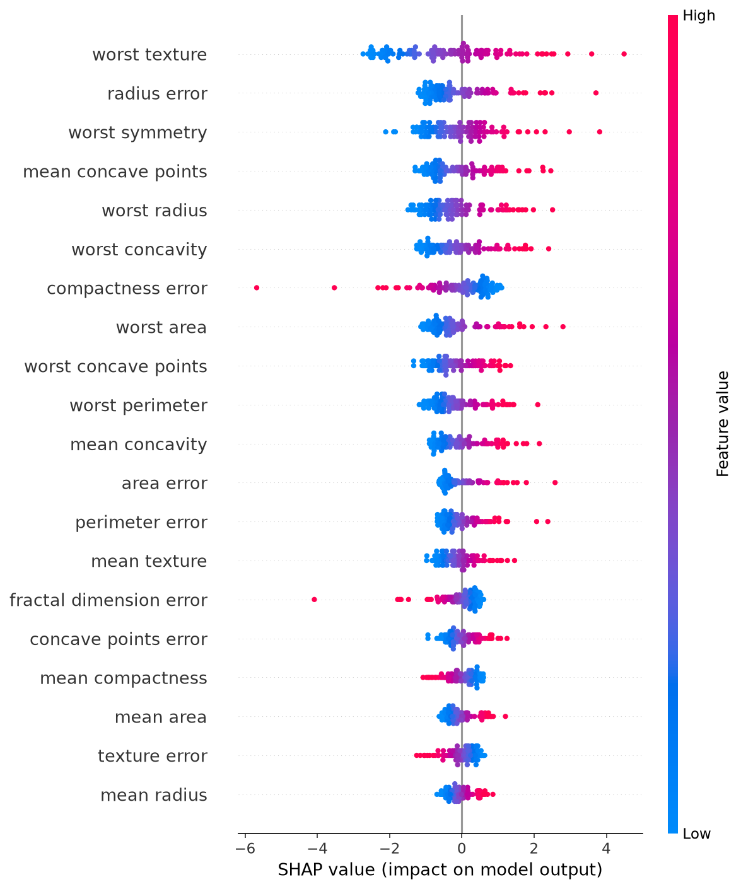

# Breast Cancer Benchmark Classification Pipeline

> **Disclaimer:** This project is a machine learning exercise built strictly for educational and portfolio purposes using a static public benchmark dataset. It is not a certified medical device, has not been clinically validated, and must not be used for medical diagnosis, treatment, or clinical decision-making.

An end-to-end, modular machine learning classification exercise built on the UCI Wisconsin Breast Cancer Diagnostic benchmark dataset (`569` samples, `30` numeric features).

This repository focuses on software and ML engineering best practices: explicit asymmetric error-cost framing, leakage-free `scikit-learn` preprocessing pipelines, cross-validated model benchmarking, out-of-fold threshold tuning, SHAP feature attribution, unit testing (`pytest`), an interactive Streamlit demo, and Docker packaging.

---

## 1. Problem Framing & Evaluation Metrics
This exercise models a binary classification task (`1 = malignant` positive class, `0 = benign` negative class) under asymmetric error-cost assumptions on a static benchmark:
* **Label Mapping Check:** `scikit-learn`'s `load_breast_cancer()` defaults to `0 = malignant, 1 = benign`. Labels are explicitly remapped in `src/data.py` so positive-class metrics evaluate the intended target (`1`).
* **Primary Evaluation Metric — Recall (Positive Class):** Measures the proportion of positive-class samples correctly identified (`TP / (TP + FN)`), minimizing False Negatives on the benchmark.
* **Guardrail Metric — Precision (Positive Class):** Measures positive predictive accuracy (`TP / (TP + FP)`), preventing trivial maximization of Recall via excessive False Positives.

---

## 2. Exploratory Data Analysis (`notebooks/01_eda.ipynb`)
* **Dataset Dimensions:** `569` samples, `30` real-valued numeric features (`mean`, `error`, and `worst` summary statistics across `10` cell-nucleus properties), `0` missing values.
* **Class Distribution:** Moderately imbalanced — **37.3% positive class (`212`)** vs. **62.7% negative class (`357`)**.
* **Feature Scale Disparity:** Input features span vastly different ranges (e.g., `mean area` max `2501.0` vs. `mean smoothness` max `0.1634`), motivating standardization for linear models.
* **Multicollinearity:** Geometric size features (`radius`, `perimeter`, `area`) show ~`0.99` pairwise correlation. All `30` features are retained for baseline benchmarking prior to any dimensionality reduction.

---

## 3. Leakage-Free Data & Preprocessing Architecture
1. **Stratified Split First (`src/data.py`):** Splits the benchmark `80/20` (`455` train / `114` test) using `stratify=y` and `random_state=42`, preserving class proportions (`0.3736` train vs. `0.3684` test).
2. **Unfitted Preprocessing Blueprint (`src/preprocessing.py`):** Defines a `ColumnTransformer` + `Pipeline` containing:
   * `SimpleImputer(strategy="median")` — defensive guard for incomplete numeric inputs at inference time.
   * `StandardScaler()` — standardizes features using parameters learned **strictly** from `X_train` (`X_train_scaled` mean: `0.000000`, `X_test_scaled` mean: `-0.024009`).

---

## 4. Model Benchmarking & Hyperparameter Tuning (`src/train.py`)

### 5-Fold Stratified Cross-Validation (`X_train` only)
| Model | Recall | Precision | F1-Score | ROC-AUC |
| :--- | :---: | :---: | :---: | :---: |
| **Logistic Regression (`C=1.0`)** | **0.9529** | **0.9771** | **0.9640** | **0.9958** |
| Gradient Boosting | 0.9471 | 0.9646 | 0.9553 | 0.9908 |
| Random Forest (`n=200`) | 0.9353 | 0.9638 | 0.9489 | 0.9889 |

* **Key Observation:** On `455` clean, continuous numeric samples, regularized `LogisticRegression` outperformed both tree ensembles across all four CV metrics.
* **Regularization Tuning (`C` in `[0.01, 0.1, 1.0, 10.0, 100.0]`):** `C=0.01` underfit (`0.8647` Recall), `C=100.0` degraded Precision (`0.9485`) and ROC-AUC (`0.9914`), and **`C=1.0`** achieved the strongest overall CV balance (`0.9529` Recall, `0.9640` F1-score, `0.9958` ROC-AUC).
* **Serialized Artifact:** Final `Pipeline` fitted on `X_train` and exported to `models/model.joblib`.

---

## 5. Threshold Optimization & SHAP Explainability

### Classification Threshold Selection (`src/evaluate.py`)
At the default `0.50` probability cutoff, evaluation on the held-out `114`-sample test split yielded `0.9286` Recall (`3` False Negatives). To prevent test-set overfitting, thresholds were evaluated using **5-fold out-of-fold CV probabilities (`cross_val_predict`) on `X_train` only**:

| Threshold | CV Recall | CV Precision | CV F1-Score | False Negatives (FN) | False Positives (FP) |
| :---: | :---: | :---: | :---: | :---: | :---: |
| `0.50` (Default) | 0.9529 | 0.9759 | 0.9643 | 8 | 4 |
| `0.40` | 0.9647 | 0.9647 | 0.9647 | 6 | 6 |
| **`0.30` (Selected)** | **0.9765** | **0.9540** | **0.9651** | **4** | **8** |
| `0.20` | 0.9824 | 0.9227 | 0.9516 | 3 | 14 |
| `0.15` | 0.9882 | 0.9032 | 0.9438 | 2 | 18 |

* **Selected Cutoff (`0.30`):** Halved CV False Negatives (`8 -> 4`) while maintaining `0.9540` Precision and achieving peak CV F1-score (`0.9651`).
* **Held-Out `X_test` Comparison (`0.50` -> `0.30`):**
  * **Recall (Positive Class):** `0.9286` -> **`0.9762`** *(False Negatives: `3 -> 1`)*
  * **Precision (Positive Class):** `0.9750` -> **`0.9762`** *(False Positives: `1 -> 1`)*
  * **F1-Score (Positive Class):** `0.9512` -> **`0.9762`**
  * **Accuracy:** `0.9649` -> **`0.9825`** | **Test ROC-AUC:** `0.9960`

### SHAP Feature Attribution (`src/explain.py`)
Uses `shap.LinearExplainer` on scaled features (`preprocessor.transform`) to compute:
* **Local Attribution:** Per-sample `+` / `-` feature contributions explaining individual model probability outputs.
* **Global Feature Importance:** Aggregated across the held-out test split:



---

## 6. Interactive Demo Application (`app/streamlit_app.py`)
* **Inference Module (`src/predict.py`):** Decouples model loading, `0.30` probability thresholding, and SHAP computation from the UI layer.
* **Streamlit Demo (`app/streamlit_app.py`):** Interactive interface for exploring benchmark test samples or synthetic numeric inputs, adjusting the decision threshold slider, and inspecting local SHAP feature contributions.
* **Data Privacy & Usage Notice:** Users must test with built-in benchmark samples or synthetic numeric values only. **Do not enter or upload real personal or patient medical data.**

---

## 7. Repository Structure
```text
breast-cancer-ml-classifier/
├── app/
│   └── streamlit_app.py   # Interactive Streamlit demo UI
├── models/
│   └── model.joblib       # Serialized leakage-free sklearn Pipeline
├── notebooks/
│   └── 01_eda.ipynb       # Exploratory Data Analysis & correlation heatmap
├── reports/
│   └── shap_summary.png   # Global SHAP feature impact summary
├── src/
│   ├── __init__.py
│   ├── data.py            # Target remapping & stratified train/test split
│   ├── preprocessing.py   # Leakage-free ColumnTransformer blueprint
│   ├── train.py           # CV benchmarking, tuning, test evaluation & export
│   ├── evaluate.py        # Out-of-fold threshold tuning & test verification
│   ├── explain.py         # Local & global SHAP feature attribution
│   └── predict.py         # Reusable inference & explanation module
├── tests/
│   ├── __init__.py
│   └── test_pipeline.py   # Pytest unit tests
├── .gitignore
├── Dockerfile
├── LICENSE
├── requirements.txt
└── README.md
```

---

## 8. How to Run Locally

1. **Create and activate a virtual environment:**
   ```bash
   python -m venv .venv
   # Windows (PowerShell): .\.venv\Scripts\Activate.ps1
   # macOS/Linux: source .venv/bin/activate
   ```
2. **Install dependencies:**
   ```bash
   pip install -r requirements.txt
   ```
3. **Run pipeline scripts:**
   ```bash
   python -m src.data
   python -m src.preprocessing
   python -m src.train
   python -m src.evaluate
   python -m src.explain
   python -m src.predict
   ```
4. **Run unit tests:**
   ```bash
   python -m pytest -v
   ```
5. **Launch the Streamlit demo:**
   ```bash
   streamlit run app/streamlit_app.py
   ```

---

## 9. License
Provided strictly "as-is" without warranty of any kind under the **MIT License** (see `LICENSE`).